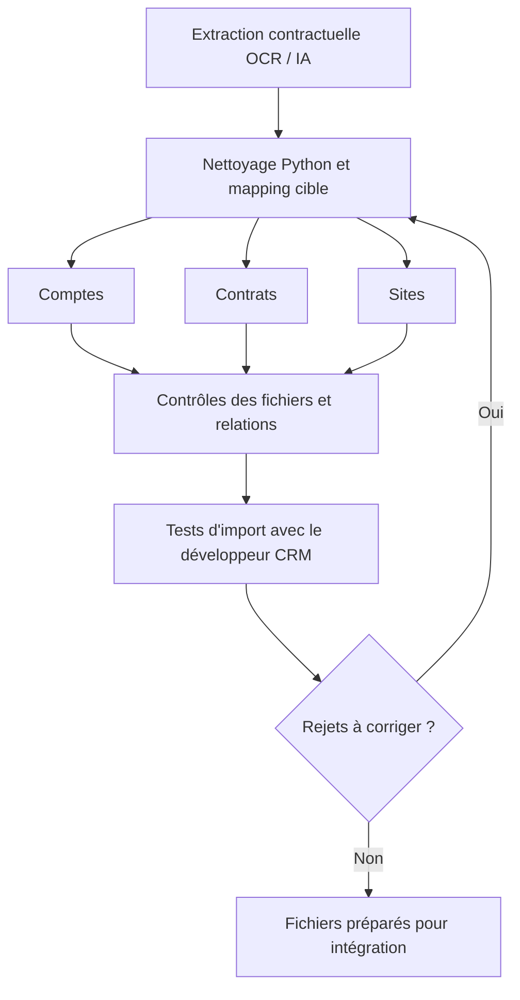
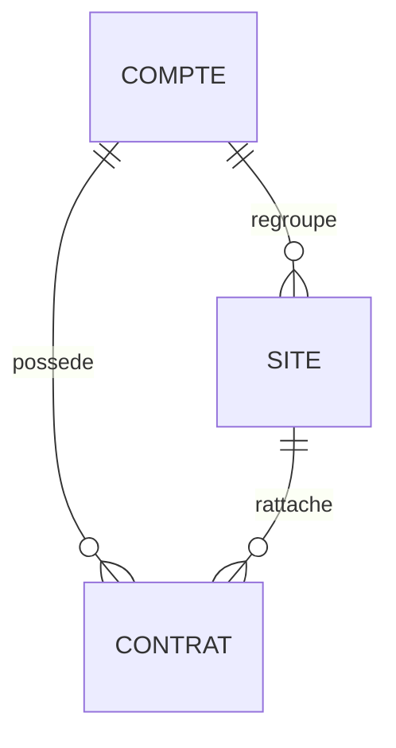
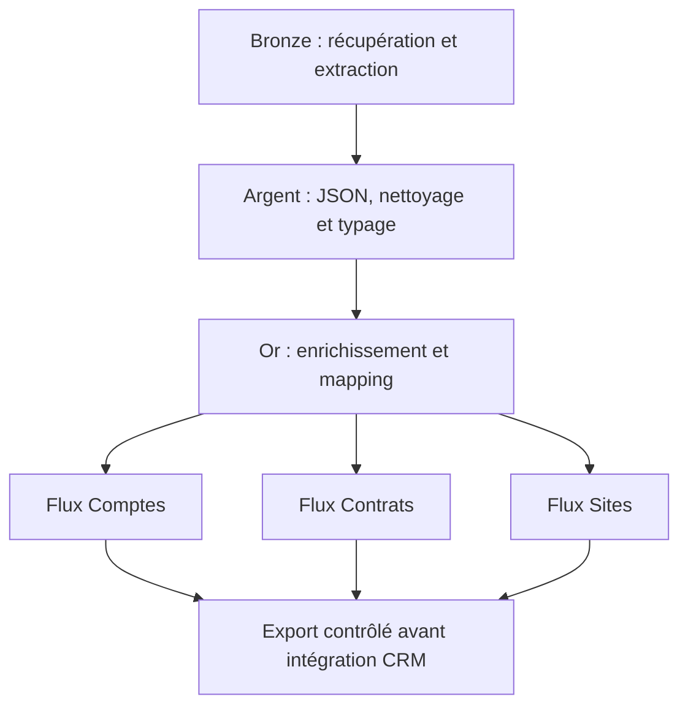

# Préparation et fiabilisation de données contractuelles pour Salesforce

**Étude de cas professionnelle anonymisée — Data Migration · Data Quality · Python/pandas · Excel**

Jean Lavital — Data Analyst

## Le problème à résoudre

Dans le cadre d'une centralisation de contrats, une extraction issue de documents numérisés et analysés par OCR/IA devait être transformée pour respecter la structure cible de Salesforce.

Le fichier source était très large et hétérogène : identifiants incomplets ou au mauvais format, adresses à uniformiser, dates incohérentes, doublons et colonnes à restructurer.

Ma mission principale était de **préparer, transformer et contrôler les données contractuelles**, afin de produire des fichiers exploitables pour leur intégration.

## Chiffres clés

| Indicateur | Valeur |
|---|---:|
| Lignes dans le fichier source | Environ 3 500 |
| Colonnes brutes | Environ 5 500 |
| Lots de traitement sous Jupyter | 4 |
| Objets CRM principaux | 3 |
| Enregistrements incomplets lors de l'analyse initiale | Environ 12 % |
| Identifiants légaux considérés valides lors de l'analyse initiale | 59 % |

**Ces chiffres proviennent de la mission réelle.** Ils décrivent le périmètre et le diagnostic initial, pas un résultat final après nettoyage.

Les contrôles de format des identifiants portaient notamment sur leur longueur et leurs caractères numériques. La conformité d'un format ne suffit pas à prouver l'existence d'une entreprise ni la bonne attribution d'un identifiant.

## Mon rôle et la collaboration

J'ai pris en charge l'essentiel du travail technique de nettoyage, de transformation et de préparation des fichiers, avec l'appui de plusieurs interlocuteurs : équipes alimentant la source, une data analyst et un consultant.

Leur connaissance du fichier et des règles métier m'a aidé à comprendre les données et les transformations attendues. J'ai travaillé à partir d'un fichier de règles décrivant le format cible.

Les opérations de pivot/dépivot dans Power Query ont été réalisées avec un appui particulier des collègues : elles ne constituaient pas la partie principale de ma contribution.

La préparation des fichiers et les corrections relevaient de mon périmètre ; le chargement et les tests d'intégration étaient réalisés en collaboration avec le développeur CRM.

## Démarche

Le schéma distingue la préparation des données des tests réalisés avec le développeur CRM. La fin du parcours représente l'objectif du traitement, pas une affirmation de zéro rejet final.

### Objets et relations du modèle cible

Vue simplifiée des relations documentées dans cette étude : les identifiants externes servent à matérialiser les rattachements avant chargement. Le modèle détaillé et ses règles restent propres au projet.

### 1. Examiner la source et les règles cibles

J'ai analysé les colonnes, les formats et les champs attendus dans Salesforce pour établir les correspondances entre la source et la cible.

L'objectif était de comprendre la structure avant d'appliquer les transformations.

### 2. Nettoyer et uniformiser les données

J'ai développé des traitements Python/pandas exécutés sous Jupyter pour :

- Harmoniser les colonnes et leurs valeurs.
- Contrôler les formats des SIREN, SIRET et codes postaux.
- Nettoyer et restructurer les champs d'adresse.
- Uniformiser les dates et les formats attendus.
- Repérer les cellules vides, les doublons et les incohérences.

Le fichier a été découpé en quatre lots pour rendre son traitement plus maniable dans l'environnement disponible.

### 3. Adapter les données au modèle Salesforce

Le mapping définissait la correspondance entre les champs sources et les champs cibles. Les données étaient ensuite organisées autour des objets **Compte, Contrat et Site**.

La restructuration comprenait des opérations de pivot/dépivot lorsque le passage du format source au format cible le nécessitait, ainsi que la préparation d'identifiants externes temporaires pour matérialiser les relations.

### 4. Contrôler les fichiers produits

| Dimension | Contrôles réalisés |
|---|---|
| Structure | Noms, ordre des colonnes et conformité à la trame cible |
| Formats | Identifiants, dates, codes postaux et valeurs attendues |
| Complétude | Champs obligatoires et cellules vides |
| Cohérence | Doublons et rattachements entre les objets |
| Enrichissement | Vérifications ou compléments à partir de sources externes, dont SIRENE |

Les transformations étaient automatisées par scripts. Les vérifications visuelles et les échanges avec les interlocuteurs métier complétaient les traitements.

La correction d'une information manquante ou incohérente nécessitait une source de référence : compléter un format ne suffisait pas à valider le contenu.

### 5. Préparer les tests d'intégration

Les fichiers préparés étaient examinés avec le développeur CRM. Les rejets constatés pendant les tests pilotes permettaient d'identifier les corrections nécessaires et d'ajuster les traitements.

## Livrables et résultats

- Fichiers homogénéisés et organisés par objet CRM.
- Mapping entre les données sources et les champs cibles.
- Relations entre objets préparées avant chargement.
- Vérification et enrichissement de champs critiques.
- Corrections successives à partir des retours des tests d'import.

Cette étude décrit la préparation et la fiabilisation des données. Elle ne revendique ni zéro rejet final ni un gain de temps chiffré.

## Outils et périmètre

| Outil ou environnement | Rôle |
|---|---|
| Python/pandas | Nettoyage, transformations et contrôles |
| Jupyter | Exécution et adaptation des traitements par lots |
| Excel | Lecture, vérification et échange des fichiers avec le métier |
| Power Query | Restructuration par pivot/dépivot, avec appui des collègues |
| Salesforce | Modèle cible et retours des tests d'intégration |
| SIRENE et autres sources externes | Vérification ou enrichissement des informations |

## Recul sur la méthode

La mission m'a appris à transformer des règles métier en traitements techniques, à travailler sur une source très large et à corriger progressivement les anomalies révélées par les tests.

Pour rendre le processus plus facilement relançable, je prévoirais aujourd'hui une zone de staging, des règles versionnées, un journal des anomalies et une séparation explicite entre corrections automatiques et validations humaines.

## Prolongement académique : POC d'automatisation

Dans un cadre académique, j'ai conçu un prototype sur données fictives pour explorer une chaîne de traitement plus automatisée :

1. **Bronze :** récupération des fichiers et extraction des contenus.
2. **Argent :** structuration JSON, nettoyage et typage.
3. **Or :** enrichissement, mapping et séparation des flux par objet CRM.
4. **Sortie :** export contrôlé avant intégration.

Ce POC utilise une approche low-code d'orchestration. Il est distinct de la mission professionnelle et **n'a pas été déployé en entreprise**.

Ce schéma concerne uniquement le prolongement académique sur données fictives.

La planification, la centralisation des logs et les contrôles systématiques sont des évolutions envisagées ; cette section ne décrit pas une plateforme de production.

## Contenu du dépôt

Ce dépôt documente l'expérience et le prolongement académique. Les fichiers contractuels et les scripts internes ne sont pas publiés.

Les résultats professionnels sont réels ; les données utilisées pour une démonstration ou pour le POC académique sont fictives.

---

**Compétences mobilisées :** mapping source-cible · nettoyage et transformation · contrôles qualité · structuration de données contractuelles · préparation à l'intégration CRM · collaboration métier et technique.
