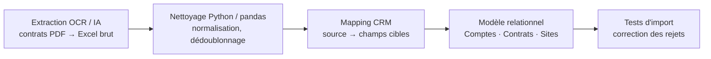
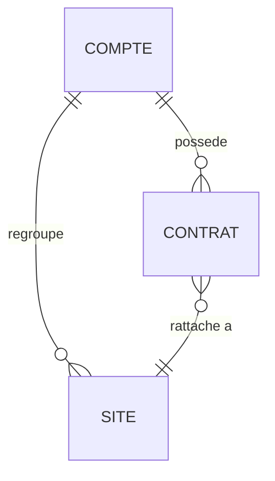
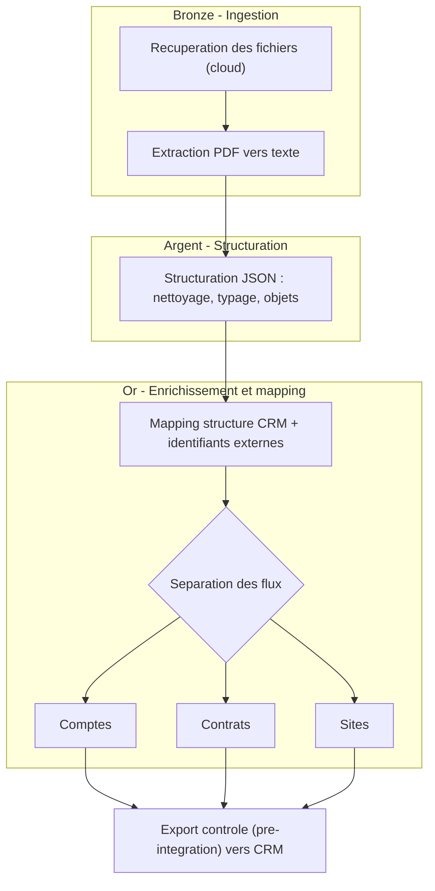

# Migration de données contractuelles vers Salesforce

**Étude de cas (anonymisée) — Data Migration · Data Quality · intégration CRM**
Jean Lavital — Data Analyst

> Dans le cadre de la centralisation des contrats d'un groupe international de services, j'ai transformé une extraction OCR/IA très volumineuse en fichiers structurés, contrôlés et conformes au modèle relationnel de Salesforce.

## Chiffres clés

| ~3 500 | ~5 500 | 4 | 3 |
|---|---|---|---|
| lignes sources | colonnes brutes | chunks de traitement | objets CRM principaux |

## Contexte et difficulté

Les contrats papier avaient été numérisés puis analysés par OCR et intelligence artificielle. L'export Excel obtenu contenait des données hétérogènes : formats de dates incohérents, SIREN et SIRET invalides, adresses incomplètes, doublons et colonnes parasites. L'analyse initiale faisait ressortir environ **12 % d'enregistrements incomplets** et seulement **59 % d'identifiants légaux valides**.

## Chaîne de traitement

1. **Extraction OCR & IA** — contrats → trame Excel brute
2. **Nettoyage Python** — chunking, normalisation et contrôles
3. **Mapping Salesforce** — correspondance source → champs cibles
4. **Modèle relationnel** — Comptes, Contrats et Sites
5. **Tests d'import** — correction progressive des rejets

## Ma contribution personnelle

- Analyser la qualité de la trame brute et caractériser les anomalies critiques.
- Stabiliser le traitement en découpant le fichier en **4 chunks** exécutés sous Jupyter.
- Développer des fonctions **Python / pandas** pour corriger les identifiants légaux, adresses, codes postaux, dates et colonnes parasites.
- Construire le **mapping source → cible** entre les données contractuelles et les champs Salesforce.
- Restructurer les données en objets **Compte, Contrat et Site**, avec pivot du format large vers le format long lorsque nécessaire.
- Créer des identifiants externes temporaires pour sécuriser les relations Compte–Contrat–Site et détecter les doublons.
- Préparer et valider les fichiers d'import avec le développeur CRM, puis corriger les rejets révélés par les tests pilotes.

## Modèle de données cible

## Contrôles qualité réalisés

| Dimension | Contrôles |
|---|---|
| Identifiants | longueur, caractères numériques, unicité |
| Formats | dates, montants, codes postaux, capitalisation |
| Relations | cohérence des rattachements entre objets |
| Complétude | champs obligatoires et enrichissement SIRENE |

## Résultats obtenus

- Trames homogènes et organisées par objet CRM.
- Relations hiérarchiques matérialisées avant chargement.
- Enrichissement des champs critiques grâce à la base SIRENE.
- Réduction progressive des rejets lors des imports pilotes.
- Fichiers conformes préparés pour l'intégration Salesforce.

## Ce que ce cas démontre

Capacité à passer d'une source très hétérogène à un modèle cible structuré, à traduire des règles métier en transformations techniques, et à fiabiliser les données jusqu'aux tests d'intégration.

## Recul technique

Je commencerais aujourd'hui par une zone de staging, un nettoyage massif en amont, des règles de qualité versionnées, une table de rejets et une orchestration avec logs — pour rendre le traitement reproductible, observable et rejouable.

## Prolongement — architecture cible automatisée (POC)

Pour prolonger la réflexion, j'ai conçu un POC d'automatisation selon une **approche médaillon Bronze → Argent → Or**, afin de rendre le traitement reproductible et industrialisable (orchestrateur low-code, structuration JSON, séparation des flux par objet, export contrôlé avant intégration).

Évolutions envisagées : contrôles qualité automatiques, logs centralisés et orchestration planifiée (cron) pour se rapprocher d'une mise en production réelle.

*Ce prototype a été réalisé dans un cadre académique, sur des données fictives ; il n'a pas été déployé en entreprise.*

---

**Compétences démontrées :** Python · pandas · Excel · SQL · Salesforce (Data Loader) · structuration JSON · orchestration low-code (POC) · qualité et migration de données

*Étude de cas anonymisée : aucune donnée réelle ni nom de client ou d'entreprise n'y figure.*
